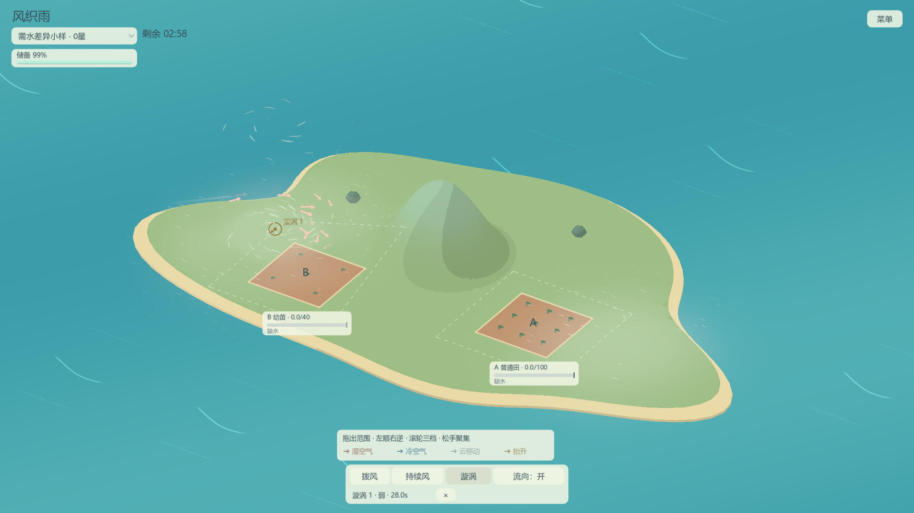

# 风织雨 / Weaving Rain

开发进度与未完成事项：[任务看板](docs/task-board.md)。

《风织雨》是一款通过拨动空气组织云雨的天气操控游戏。你用鼠标推动湿空气，借山坡抬升成云，也可以借降雨产生的冷风，在新的位置组织下一场雨，把适量的雨送到需要水的土地上。

快划更猛，慢划更柔；松手后，气流与云仍会继续运动。雨云积存的水不会立即消失，给土地浇够水后，还要处理继续降雨的风险。

底部可选 **拨风、持续风、漩涡**。拨风拖出方向后，停住鼠标并按住可继续吹，再次拖动可调整方向和轻重。持续风拖动确定一条风带，滚轮向上增强、向下减弱，末端力度计从上到下为红色强风、绿色中风、蓝色弱风，每次放置默认中档。松手后整条风带持续吹，宽度与拨风相同；默认最多两个风源，各吹 30 秒，最后 2 秒逐渐减弱。点击下方风源旁的 × 可提前撤掉，已有风仍会自然衰减；持续补给也可能让雨水过量，需要留意收尾。

**流向提示** 可开关：操作附近的珊瑚红箭头表示湿空气、蓝色表示冷空气、浅白表示云的实际移动，金色上升箭头表示确实发生的造云。风带的金色方向标记表示覆盖、施力方向与寿命，不是保证抵达土地的预测路线。力度计的颜色只表示强弱，不模拟温度。

选中 **漩涡**，按下位置作为中心，拖动距离决定半径；左键顺时针、右键逆时针，滚轮选择弱／中／强，默认中档。松开起手按键生成，点击不拖动不造风，另一按键不改变当前手势。预览白线展示旋向，生成后的白线读取实际气流；范围圈只在预览或悬停时出现。风场位置、范围与档位在生成后固定，可用下方 × 关闭，再拨风或放风带输送。风带与漩涡合计最多两个，均默认持续 30 秒；集中云雨也会增加过量风险。

## 运行

使用 **Godot 4.7.2 stable 标准版**导入本目录的 `project.godot`，按 **F5** 运行。项目使用 GDScript，无需 .NET 或第三方插件。

## 游玩

第一次启动先进入单目标入门：短提示随实际成云、降雨、水量和安全状态推进，金色标记指出当前可操作的位置。全程可以自由拨风，也可以直接跳过。入门完成后，点击进入 A、B 双目标自由局；自由局可随时重看入门。

进入过自由局后，下次启动会直接回到自由局。R 只重试当前局面。首次出现可见冷空气时会提示可选的接力方法，提示可关闭，也会自动收起。

自由局左上角可选择三个固定局面与多山测试图，也会列出另存到地图目录的有效资源。切换后从湿空气重新开始；重看入门再返回时，会保留本次选中的局面。

打开右上方 **菜单 → 星级测试**，或在左上方选择“三处田园”“两山分雨”等测试局。土地须适量且连续安全才算保住。评价固定为三颗星：零块保住是零星，全部保住是三星，未全部保住且只保住一块是一星，其余是二星。**一星即可完成**；可以继续争取更多，也可安全收尾后结算。未损坏土地附近仍有危险天气时，需先处理天气。重试和重看入门也在菜单内，R 始终可以重试。

A/B/C 的小水量条位于各自地块旁，按所需水量填满，够水后随容错余量减少从蓝色逐渐变黄，超过上限立即变红；悬停查看具体适量区间和安全原因。满条表示够水，仍需确认安全才能得星。这些信息、计时、储备及文字提示都允许拨风穿透。底部操作说明和颜色图例短暂显示后收起。白色细丝统一表示实际气流，覆盖拨风、按住续吹、持续风带、残留风和低空冷风，即使没有水汽也能出现；关闭箭头仍保留风线。

星级关卡当前每关限时 **3 分钟**，左上角显示剩余时间。到时自动结算，只计算已适量并连续安全的地块；仍有危险天气、未浇够或已损坏的地块不计星。一星以上通关，零星可重试；水汽耗尽也会在到时结束。暂停冻结计时，R 重新计时；入门与自由练习局不限时。3 分钟是可调整的测试初值。

倒计时下方的 **天气储备** 条显示剩余水汽与云中储水，占开局水分的比例。水汽变成云仍属于储备。剩余储备不足以浇够任何新地块时，提示“剩余水分不足”，开放“结束本局 · 当前 X 星”；零星也能结束重试。你可以继续整理天气，让已够水的地块安全得星；选择结束时只计算当前已安全的地块。

任意田数的星级测试局 **全部保住** 后，结算按钮显示“3 秒后自动结算”，也可点击立即结束。倒数期间仍能拨风，天气继续运行；任一地块失去安全状态就取消，重新全部保住后从头倒数。暂停冻结倒数。结果分别显示保住数量与评价星数。

星级测试中，地块过量后永久损坏，但可以继续照顾其他地块；全部损坏也会自动结束。够水、保住和损坏时，地块短暂强调并提示。结果逐田列出水量和未保住原因，并可重试或进入下一测试局。最高星数不会因重试降低；旧纪录先备份再迁移，未知田数的自定义图纪录另存为历史。地块支持矩形、圆形和椭圆，水量按面积换算，仍按真实落雨位置累计。

“三处田园”用一座山照顾三处土地；“两山分雨”提供不同造云位置，也可借冷风接力。两图已有正常开局的三星技术回放，见 [路线记录](docs/star-route-review.json)。它们目前都是测试局，正式关序与难度尚未确定。

| 局面 | 可尝试的操作 |
| --- | --- |
| 山与两处土地 | 原有布局，比较山坡搬云与冷风接力 |
| 长岛输雨 | 山在西端，把雨送到中部与东端，或借当地湿空气补给 |
| 双翼分雨 | 山在中央，两处土地分列东西两翼，可尝试不同浇雨顺序 |
| 两山两路 | 多山编辑测试图，尝试分别借两座山组织补给 |
| 需水差异小样 | A 普通田需 100–150，B 幼苗需 40–55；两块同面积，比较输雨力度与提前移云时机，全保住自动三星结算 |

1. 把浅色细丝表示的湿空气推向山坡，让它抬升成云。拨动时的短风线提示气流方向。
2. 从云边轻拨，调整落点并收拢厚云；保持片刻后开始降雨。
3. 留意 A、B 两处水量，提前移云，给继续释放的储水留出余量；也可以切断补给，等待雨云逐渐耗尽。
4. 灰蓝色薄层与短纹表示冷空气。把湿空气迎向冷风前沿，形成汇聚才能抬升；同向飘走或仅接触不够。冷空气可以拨动，使用后会减弱，降雨可以补充。
5. 两处地块都在适量区间、各自周围天气安全后完成；任一处过量可立即重试。山坡路线也能完成，无需强制使用接力。

原有地图默认适量范围为 **100–150**。新增“需水差异小样”可以从布局列表选择，幼苗需水较少也更怕过量；植物会随接雨轻微长高，损坏后转褐下垂。配置可直接编辑 `configs/plots/ordinary.tres`、`seedling.tres`，保存后 R 重试或重新选图生效，F6 不改变本局需求。这些都是测试数值，后续会调整；正式空心雨滴 UI 留待美化。

静止湿空气也会轻微浮动、明暗起伏，帮助发现可拨动的位置；水平移动仍由实际风决定。海面长短线是装饰水纹，操作附近出现并随气流移动的短风线才表示拨风。

| 操作 | 作用 |
| --- | --- |
| 左键拖动并按住 | 拨风模式：拖动加风，停住后沿最近方向续吹 |
| 持续风模式下拖动、松手 | 沿起终点创建整段持续施力的风带 |
| 放置风带时滚轮上／下 | 增强／减弱，三档力度计跟随末端 |
| 漩涡模式左／右键拖动、滚轮、松手 | 拖半径、左顺右逆、滚轮三档，松开起手键生成 |
| 风源旁的 × | 撤除该风源，已有风继续自然衰减 |
| 流向提示按钮 | 开关天气箭头，保留风源位置标记 |
| R | 重试当前入门或自由局 |
| 空格 | 暂停 / 继续 |
| F2 | 开发用云交互小样，不计通关 |
| F3 | 显示 / 隐藏调试信息与开发小样按钮 |
| F4 | 开发用冷风交互小样，不计通关 |
| F6 | 开发运行中重读已保存配置，立即应用拨风与云响应 |

天气可以吹入岛外海域并逐渐离开，不会自动补回。地图编辑和手感配置见 [地图编辑与调参](docs/map-authoring.md)：打开 `scenes/map_editor.tscn` 可拖动山、目标和湿空气；全局参数位于 `configs/weather.tres`。

## 项目状态

目前已有单目标入门、四个练习局面、两个三地块星级测试关及两地块需水差异小样。地图支持多山、三种地块形状与各块独立需求，仍只有单一云层。视觉采用平滑轮廓与分层色块，云、水汽和冷风的形态由实时数据生成。

不同需求配置、蓝黄红水条、植物占位反馈及编辑关联已接入，用户已完成需水小样试玩并反馈没有问题。当前左右键／滚轮漩涡和圆润水汽覆盖 697 项检查、23 条完整流程；全套在测试相机引用处中断，修整测试后续跑通过，并补查暂停瞬间门禁。新版正常湿空气开局已完成三星，见 [本轮验证](docs/vortex-placement-review.json)。此前两圈方案记录保留为历史；新版手感与正式关卡难度待用户试玩确认。

本轮 1920×1080 三种风源组合的 18 项短诊断有 11 项未满足门槛，部分模拟推进不足、存在积累；同项显示对照后的复测恢复到门槛内，首轮失败仍保留。不能据此宣布性能通过，也不能单独归因新显示。两张测试图的正式 60 秒长采样按约定留到空闲时，[看板](docs/task-board.md)保留验收与此前异常。灌溉两块田偏难的反馈保留；龙卷风／台风、风主题评价与正式雨滴 UI 留后续讨论。

[策划与讨论记录](docs/cloud-weather-game-design-v0.1.md) · [开发协作说明](AGENTS.md)

本轮漩涡操作与圆润水汽见 [实施与验证记录](docs/vortex-placement-review.json)，前一轮[手势与评价方案](docs/vortex-and-rating-implementation-plan.md)保留为历史。四田以上只验证评价函数，地图编辑目前仍限一至三田。风主题评价造型及空心雨滴 UI 留待后续。
