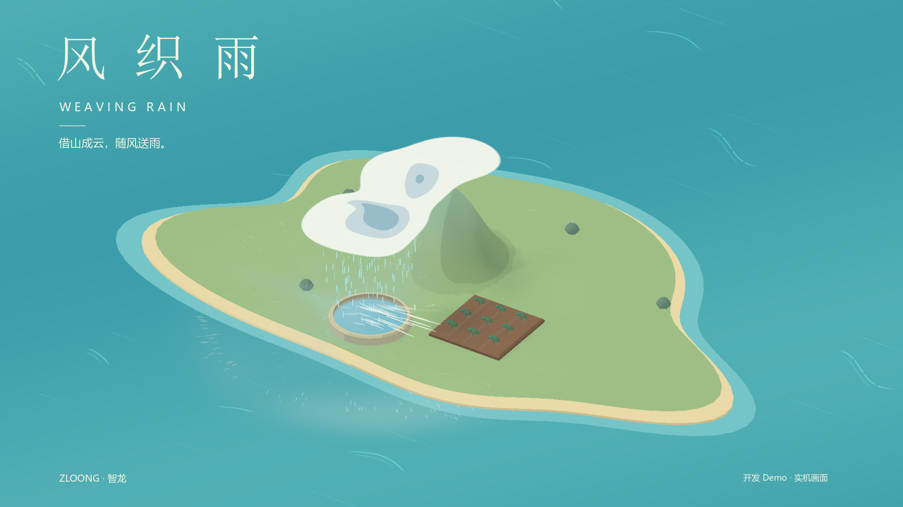
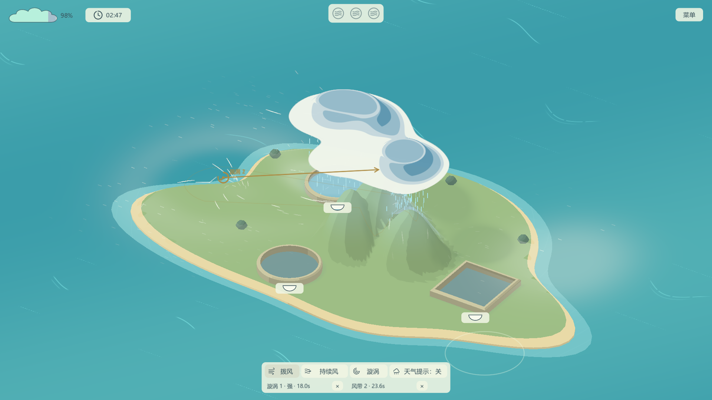
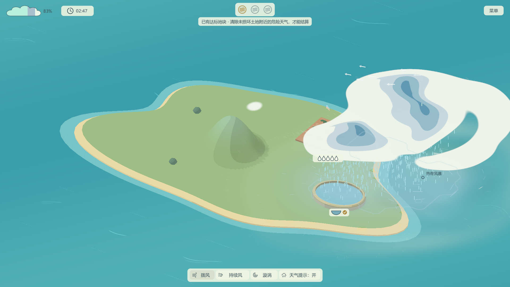

<!-- contentType: Landing; audience: players and developers; goal: discover the game, play the Windows demo, and find project guides. -->

# 风织雨 · Weaving Rain

**拨一阵风，织一场雨。**

用鼠标推动空气，把雨送到群岛上需要它的地方。

[在 TapTap 试玩](https://www.taptap.cn/app/981551?os=pc) · [宣传片 MP4](docs/demo-delivery/visuals/weaving-rain-trailer.mp4) · [游玩指南](docs/demo-delivery/PLAYER_GUIDE.md) · [开发文档](docs/README.md) · [反馈问题](https://github.com/Dragonzhi/Weaving-Rain/issues)

*聚光灯 21 天 GameJam 参赛作品 · 制作：ZLOONG · 智龙*

## 把一场雨送到需要它的地方

《风织雨》是一款天气操控解谜游戏。推动湿空气，让它迎着山坡抬升成云，再把云雨送往农田与水库。风停后，云仍会移动，雨也不会立刻停下；观察天气，决定先浇哪里，以及什么时候收手。

你可以用这些办法组织天气：

- **拨动空气**：拖动鼠标施风，停住并按住可沿最近方向续吹
- **留下风带**：让一条持续的气流替你输送水汽，再去照顾另一处天气
- **收拢漩涡**：把分散的空气聚到一起，关闭漩涡后再转送
- **借用天气**：利用山坡、雨后冷风和暖海风暴，寻找不同的造雨路线

农田需要适量的雨，浇够后还要安全收尾；水库蓄满便完成，可以承接余雨。部分目标受损后，你仍能继续挽救其余目标。

<table>
  <tr>
    <td width="50%"></td>
    <td width="50%"></td>
  </tr>
  <tr>
    <td align="center"><b>留风聚云</b> 安排气流，让云雨继续前行</td>
    <td align="center"><b>海上借雨</b> 引导风暴，也留意过量的雨</td>
  </tr>
</table>

封面来自实机画面排字，图集为开发期实机截图；界面细节以当前 Demo 为准。35 秒宣传片见上方入口。

## 开始试玩

当前 Demo 面向 **Windows 电脑，使用鼠标与键盘**。前往 [TapTap《风织雨》PC 页面](https://www.taptap.cn/app/981551?os=pc) 获取试玩，第一次从「开始旅程」进入水库教学。

Demo 包含一份水库教学与九张关卡，逐步加入农田、多山、风带、漩涡和自然风暴。工具按关卡开放，不需要在第一关记住所有操作。

| 操作 | 作用 |
| --- | --- |
| 左键拖动 | 拨风；快划更强，慢划更柔 |
| 拖出方向后停住并按住 | 沿最近方向继续吹 |
| 风带／漩涡工具中拖动、滚轮、松手 | 设置方向或范围，选择三档力度并放置 |
| 风源旁的 `×` | 提前撤除风源，已有气流自然衰减 |
| 底栏居中角标 | 收起／展开工具栏 |
| `F11` | 全屏／窗口切换 |
| `空格` / `Esc` / `R` | 暂停／菜单／重试 |

天气提示默认关闭，需要观察流向和实际落雨范围时可在底栏开启。更多操作、地块状态与风纹评价见[游玩指南](docs/demo-delivery/PLAYER_GUIDE.md)。

当前 Demo 状态与已知问题

- 当前本地归档版本为 **0.1.2**，源码标签为 [`v0.1.2`](https://github.com/Dragonzhi/Weaving-Rain/tree/v0.1.2)；平台分发版本以 TapTap 页面为准
- Windows 包默认使用 **Forward+ / Vulkan**，附 D3D12 备用启动脚本
- 密集天气仍有性能待项；尚未完成所有设备、九关难度与长时稳定性验收
- 第四关自动截图后退出曾出现音频资源清理警告，已留档，根因仍待排查
- 构建范围、散列和验证边界见[0.1.2 交付记录](docs/demo-delivery/package-0.1.2-2026-10-20.md)，开发进度见[任务看板](docs/task-board.md)

## 从源码运行与制作关卡

使用 **Godot 4.7.2 stable 标准版**导入根目录的 `project.godot`，等待资源导入后按 **F5**。项目使用 GDScript，无需 .NET。

关卡与手感可以通过 Godot 资源调整：

| 想做什么 | 入口 |
| --- | --- |
| 制作自己的关卡 | [关卡编辑器指南](docs/level-editor-guide.md) |
| 配置山体、水汽、目标与暖海 | [地图编辑与调参](docs/map-authoring.md) |
| 调整正式关序 | `configs/campaign.tres` |
| 调整风力与天气参数 | `configs/weather.tres` |
| 查阅玩法设计、显示与验证 | [文档导航](docs/README.md) |
| 查看协作约束与验证方法 | [AGENTS.md](AGENTS.md) |

## 反馈与鸣谢

欢迎通过 [GitHub Issues](https://github.com/Dragonzhi/Weaving-Rain/issues) 或 [TapTap 游戏论坛](https://www.taptap.cn/app/981551/topic) 反馈。描述所在关卡、操作、预期与实际结果，并附设备信息；截图或短视频也有帮助。

制作：**ZLOONG · 智龙**。背景音乐为 Écrivain 的《Meadow Thoughts》，风雨声音使用已注明来源的素材与程序生成短音。作者、来源及授权范围见[制作与素材鸣谢](docs/demo-delivery/CREDITS.md)。仓库目前未声明统一项目许可证，第三方素材许可不代表整个游戏的许可。

About the game

**Weaving Rain** is a weather-control puzzle game made with Godot and GDScript for a 21-day GameJam. Guide moist air up mountain slopes, shape clouds, and carry rain to fields and reservoirs. Use wind bands, vortices, and changing weather to plan your own route. The current demo is for Windows PC with mouse and keyboard controls.

