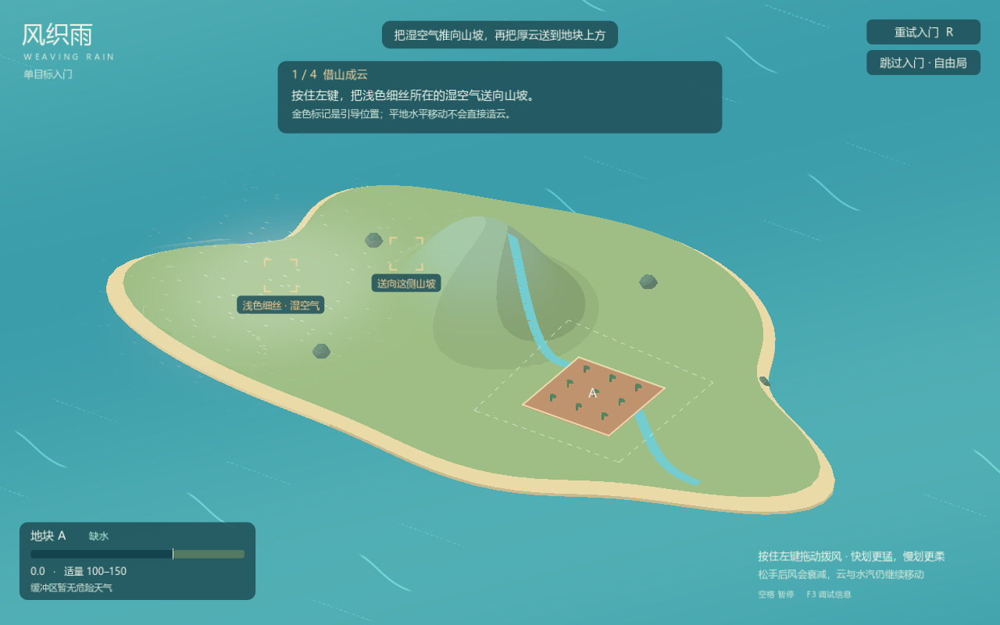

# 风织雨 / Weaving Rain

《风织雨》是一款通过拨动空气组织云雨的天气操控游戏。你用鼠标推动湿空气，借山坡抬升成云，也可以借降雨产生的冷风，在新的位置组织下一场雨，把适量的雨送到需要水的土地上。

快划更猛，慢划更柔；松手后，气流与云仍会继续运动。雨云积存的水不会立即消失，给土地浇够水后，还要处理继续降雨的风险。

## 运行

使用 **Godot 4.7.2 stable 标准版**导入本目录的 `project.godot`，按 **F5** 运行。项目使用 GDScript，无需 .NET 或第三方插件。

## 游玩

第一次启动先进入单目标入门：短提示随实际成云、降雨、水量和安全状态推进，金色标记指出当前可操作的位置。全程可以自由拨风，也可以直接跳过。入门完成后，点击进入 A、B 双目标自由局；自由局可随时重看入门。

进入过自由局后，下次启动会直接回到自由局。R 只重试当前局面。首次出现可见冷空气时会提示可选的接力方法，提示可关闭，也会自动收起。

1. 把浅色细丝表示的湿空气推向山坡，让它抬升成云。拨动时的短风线提示气流方向。
2. 从云边轻拨，调整落点并收拢厚云；保持片刻后开始降雨。
3. 留意 A、B 两处水量，提前移云，给继续释放的储水留出余量；也可以切断补给，等待雨云逐渐耗尽。
4. 灰蓝色薄层与短纹表示冷空气。把湿空气迎向冷风前沿，形成汇聚才能抬升；同向飘走或仅接触不够。冷空气可以拨动，使用后会减弱，降雨可以补充。
5. 两处地块都在适量区间、各自周围天气安全后完成；任一处过量可立即重试。山坡路线也能完成，无需强制使用接力。

当前原型以 **100–150** 为适量范围。这是用于验证操作的测试数值，后续会调整。

静止湿空气也会轻微浮动、明暗起伏，帮助发现可拨动的位置；水平移动仍由实际风决定。海面长短线是装饰水纹，操作附近出现并随气流移动的短风线才表示拨风。

| 操作 | 作用 |
| --- | --- |
| 左键拖动 | 拨动局部空气 |
| R | 重试当前入门或自由局 |
| 空格 | 暂停 / 继续 |
| F2 | 开发用云交互小样，不计通关 |
| F3 | 显示 / 隐藏调试信息与开发小样按钮 |
| F4 | 开发用冷风交互小样，不计通关 |

## 项目状态

目前已有单目标入门与双目标自由局，使用同一个岛屿、一座山和单一云层。视觉采用平滑轮廓与分层色块，云、水汽和冷风的形态由实时数据生成。

规则、引导状态、视口按钮及完整回放已通过，用户试玩确认此前冷风行为与双目标闭环可用。新增引导仍待玩家试玩，水汽对初次玩家的可读性及接力的便利程度仍需验证。完整多地块损失评价、助手与正式音乐尚未加入。

[策划与讨论记录](docs/cloud-weather-game-design-v0.1.md) · [开发协作说明](AGENTS.md)
