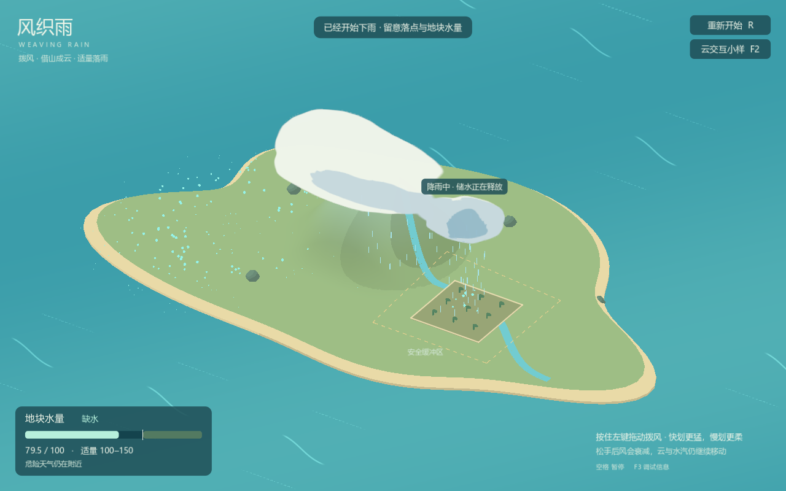

# 风织雨 / Weaving Rain

《风织雨》是一款通过拨动空气组织云雨的天气操控游戏。你用鼠标推动湿空气，借山坡抬升成云，再调整云的位置和厚度，把适量的雨送到需要水的土地上。

快划更猛，慢划更柔；松手后，气流与云仍会继续运动。雨云积存的水不会立即消失，给土地浇够水后，还要处理继续降雨的风险。

## 运行

使用 **Godot 4.7.2 stable 标准版**导入本目录的 `project.godot`，按 **F5** 运行。项目使用 GDScript，无需 .NET 或第三方插件。

## 游玩

1. 把左侧的青色湿空气推向山坡，让它抬升成云。
2. 从云边轻拨，调整落点并收拢厚云；保持片刻后开始降雨。
3. 观察地块水量。进入适量范围后，移开雨云，或切断补给并等待储水耗尽。
4. 地块水量适量、周围天气安全后完成；浇水过量则重试。

当前原型以 **100–150** 为适量范围。这是用于验证操作的测试数值，后续会调整。

| 操作 | 作用 |
| --- | --- |
| 左键拖动 | 拨动局部空气 |
| R | 重新开始 |
| 空格 | 暂停 / 继续 |
| F2 | 云交互小样，单独体验云的变形 |
| F3 | 显示 / 隐藏调试信息 |

## 项目状态

目前是一个岛屿、一座山、单一云层和一个受雨地块的最小可玩原型，正在验证局部拨风、云的收拢和雨量控制。视觉采用平滑轮廓与分层色块，云的形态由实时数据生成。

后续的冷风连锁、多地块、助手与正式音乐尚未加入，当前画面和手感仍会迭代。

[策划与讨论记录](docs/cloud-weather-game-design-v0.1.md) · [开发协作说明](AGENTS.md)
