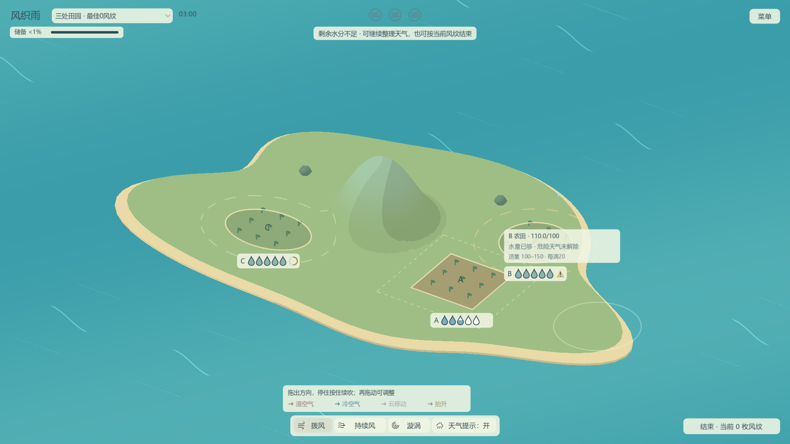
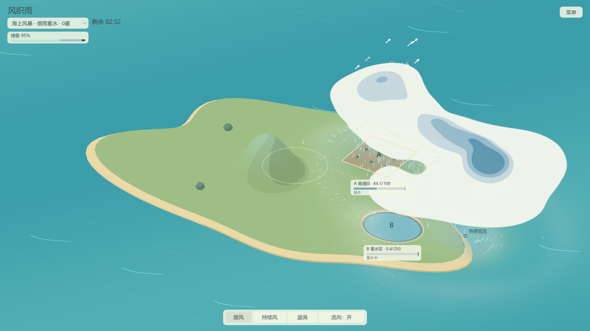

# 风织雨 / Weaving Rain

开发进度与未完成事项：[任务看板](docs/task-board.md)。

入口界面采用 B「风过群岛」：居中岛屿、横向菜单与九宫格选关。风掠切页、薄云换关，设置／暂停轻淡入；设置可减少转场动态，揭幕完成后才推进天气与计时。返回主界面可暂停并保留本局；页面与缩略图调整见[主界面指南](docs/front-menu-guide.md)。

自己制作关卡：[新建关卡与编辑器指南](docs/level-editor-guide.md)，从现有模板另存、配置目标／水汽到试玩；已确认的[教学与关卡流程安排](docs/level-flow-plan.md)为教学 → 单田 → 双目标 → 风暴＋蓄水区。

正式关序在`configs/campaign.tres`的`Levels`数组中调整，当前收录用户制作的`level01`至`level09`。九关从单池、双池逐步加入农田、多山与风暴，名称、提示和逐关建议见[九关内容核对](docs/level-content-review.md)。新图保存后拖进数组、排序并保存，游戏里打开“菜单 → 选关”即可重读；教学单独引用，旧测试图从开发地图入口独立试玩。

工具按关开放：教学和1–4关只有拨风，5–6关加入风带，7–9关加入漩涡。地图资源中的`Available Wind Tools`勾选项可直接调整，保存后R／切图生效；旧测试图默认全开。首次开放新工具会简短说明，详见[工具配置指南](docs/tool-availability.md)。

当前界面方向：[视觉规范](docs/visual-language/DESIGN.md)、[认可的参考图](docs/visual-language/reference-images.md)与[UI实施计划](docs/ui-implementation-plan.md)。雨滴、池水位、悬浮状态和风纹奖章已接入，验证记录见[UI实施记录](docs/ui-review.json)。

[场景立体感计划](docs/scene-volume-implementation-plan.md)已在 `codex/scene-volume` 分支接入统一光向、云影、土侧面和池内壁，见[实施记录](docs/scene-volume-review.json)。[三张概念参考](docs/visual-language/scene-reference-images.md)说明方向，实际效果仍待试玩。

[地面第二轮](docs/ground-volume-implementation-plan.md)以用户指定的原整体图为最终风格目标，强化田台／田垄、双叶植株、满池内壁和山影。[当前实机对比与检查](docs/ground-volume-review.json)区分显示夹具、正常鼠标路线和未通过的性能项；美术参数可在 `configs/scene_style.tres` 调整，保存后R重读。

2026-10-14本轮获授权提交并并入 `main`；`codex/scene-volume` 保留为实施历史。

《风织雨》是一款通过拨动空气组织云雨的天气操控游戏。你用鼠标推动湿空气，借山坡抬升成云，也可以借降雨产生的冷风，在新的位置组织下一场雨，把适量的雨送到需要水的土地上。

快划更猛，慢划更柔；松手后，气流与云仍会继续运动。雨云积存的水不会立即消失，给土地浇够水后，还要处理继续降雨的风险。

底部可选 **拨风、持续风、漩涡**。拨风拖出方向后，停住鼠标并按住可继续吹，再次拖动可调整方向和轻重。持续风拖动确定一条风带，滚轮向上增强、向下减弱，末端力度计从上到下为红色强风、绿色中风、蓝色弱风，每次放置默认中档。松手后整条风带持续吹，宽度与拨风相同；默认最多两个风源，各吹 30 秒，最后 2 秒逐渐减弱。点击下方风源旁的 × 可提前撤掉，已有风仍会自然衰减；持续补给也可能让雨水过量，需要留意收尾。

**天气提示** 可统一开关流向箭头和地面降雨范围。淡蓝覆盖与细轮廓取自实际落到地面的雨；悬停或拨动雨云时，对应雨区会短暂加强。它表示此刻的落雨范围，不表示地块累计水量或安全范围。珊瑚红箭头表示湿空气、蓝色表示冷空气、浅白表示云的实际移动，金色上升箭头表示确实发生的造云。风带的金色方向标记表示覆盖、施力方向与寿命，不是保证抵达土地的预测路线。力度计的颜色只表示强弱，不模拟温度。白色风线、实际雨线及风源标记在关闭天气提示后仍保留。

选中 **漩涡**，按下位置作为中心，拖动距离决定半径；左键顺时针、右键逆时针，滚轮选择弱／中／强，默认中档。松开起手按键生成，点击不拖动不造风，另一按键不改变当前手势。预览白线展示旋向，生成后的白线读取实际气流；范围圈只在预览或悬停时出现。风场位置、范围与档位在生成后固定，可用下方 × 关闭，再拨风或放风带输送。风带与漩涡合计最多两个，均默认持续 30 秒；集中云雨也会增加过量风险。

## 运行

使用 **Godot 4.7.2 stable 标准版**导入本目录的 `project.godot`，按 **F5** 运行。项目使用 GDScript，无需 .NET 或第三方插件。

本地Windows试玩包位于 `.godot/WeavingRain-preview.zip`，当前为地面第二轮分支版，也另存为 `.godot/WeavingRain-ground-volume.zip`及场景分支通用包。首轮场景备份为 `.godot/WeavingRain-scene-first-fb97505.zip`，UI基线保留为 `.godot/WeavingRain-ui-baseline-8f24ca7.zip`。解压后运行 `WeavingRain.exe`；`PlayReservoir.cmd`／`PlayStorm.cmd` 可直接进入两份新增小样。无需安装Godot，正式性能与新场景体验仍待验收。

## 游玩

当前源码已接入风雨音效：拨风从有效移动时单次发声，五条差分轮换、音高随手速变化；持续气流和小雨／A密雨跟随真实天气。放源与地块状态变化也有短反馈。主界面或右上菜单的“声音设置”可关闭音效、调整音量。开发期直接Godot运行；已有独立包仍是音效前的地面版，本轮不新增包。

普通启动先显示主界面，首次点击“开始旅程”进入水库入门：把湿空气推向山坡，观察成云降雨，再让雨水填满水库。蓄满即完成，不怕溢出，也不要求移云或等待安全；后续农田关再练习控制雨量与安全收尾。全程可以自由拨风或跳过，完成／跳过后进入正式列表第一关，菜单可重看入门并返回原地图。教学地图和容量可独立编辑，见[修改教学关](docs/level-editor-guide.md#修改现有教学关)。

进入过正式关卡后，下次启动仍显示主界面，点击“开始旅程”进入正式列表第一关。本次运行已有进行中的局面时，主按钮显示“继续本局”；返回主界面不会清空天气，关闭程序后不恢复本局天气。R只重试当前地图。首次出现可见冷空气时会提示可选的接力方法，提示可关闭，也会自动收起。

正式选关按配置显示顺序和最高风纹。开发运行的“菜单 → 开发地图”保留固定局面、多山和另存到地图目录的有效资源，独立于正式顺序；切换重新开局，重看入门再返回会保留本次选中的地图。

新增 **蓄水区小样** 与 **海上风暴 · 借雨蓄水**，各有一块农田和一个蓄水区。池容量为250测试单位，蓄满便完成，继续下雨或溢流不会损坏，也不要求附近停雨；农田仍需100–150且连续安全。完成一个目标获得一枚风纹，两个全完成获得三枚风纹并自动倒数。

热带主题图的暖海会持续有限速补入湿空气，强天气久留后供能逐渐减弱。湿度与持续汇聚足够才能海上成云；自然低压／风暴可以维持环流，也会随供给变化衰弱。外围拨风或风带能慢慢影响其走向。**关闭人工风源不会删除自然天气**，已有雨云仍会继续释放储水。开场云来自这张图初始水汽的转移，普通图的开局保持原样。

打开右上方 **菜单 → 选关** 选择正式地图；“三处田园”“两山分雨”等旧样本留在开发地图中。土地须适量且连续安全才算保住。评价最高为三枚风纹：零块保住为零枚，全部保住为三枚，未全部保住且只保住一块为一枚，其余为两枚。**一枚即可完成**；可以继续争取更多，也可安全收尾后结算。未损坏土地附近仍有危险天气时，需先处理天气。重试和重看入门也在菜单内，游玩时按R可以重试。

A/B/C 的空心雨滴位于各自地块旁，每滴默认20单位，普通田五滴、幼苗两滴；非整倍数末滴按余量填满，较大需求用“×N”分组，悬停查看准确容量。蓄水区用独立水位容器。农田够水后随过量余量减少从蓝色逐渐变黄，损坏立即红；旁边提醒符号、小安全环和完成勾分别表示风险、确认与保住。满滴只表示水够，不代表完成。悬停展开一层准确水量与原因，状态变化仅短暂显示浮字。这些信息、计时、储备及文字提示都允许拨风穿透。底部操作说明和颜色图例短暂显示后收起。白色细丝统一表示实际气流，覆盖拨风、按住续吹、持续风带、残留风和低空冷风，即使没有水汽也能出现；关闭箭头仍保留风线。

风纹测试关卡当前每关限时 **3 分钟**，左上角显示剩余时间。到时自动结算，只计算已适量并连续安全的地块；仍有危险天气、未浇够或已损坏的地块不计风纹。一枚以上通关，零枚可重试；水汽耗尽也会在到时结束。暂停冻结计时，R 重新计时；入门与自由练习局不限时。3 分钟是可调整的测试初值。

左上角的 **天气储备** 条显示剩余水汽与云中储水，占开局水分的比例。水汽变成云仍属于储备。剩余储备不足以浇够任何新地块时，提示“剩余水分不足”，开放“结束本局 · 当前 X 枚风纹”；零枚也能结束重试。你可以继续整理天气，让已够水的地块安全获得评价；选择结束时只计算当前已安全的地块。

暖海仍能补给时，悬停储备条会说明“海域仍在补给”，不会据当前储备判断无法继续完成；供给耗弱至停止后恢复原不足判断。补给不延长时限。

任意田数的风纹测试局 **全部保住** 后，结算按钮显示“3 秒后自动结算”，也可点击立即结束。倒数期间仍能拨风，天气继续运行；任一地块失去安全状态就取消，重新全部保住后从头倒数。暂停冻结倒数。结果分别显示目标完成数量与风纹评价。顶部小奖章是本局当前评价，地图选择标注的是历史最佳，悬停可查看两者。

计风纹的关卡中，地块过量后永久损坏，但可以继续照顾其他地块；全部损坏也会自动结束。够水、保住和损坏时，地块短暂强调并提示。结果逐田列出水量和未保住原因，可重试或选关；正式列表内通过后可进入下一关，末项返回选关。最高风纹纪录不会因重试降低；旧纪录先备份再迁移，未知田数的自定义图纪录另存为历史。地块支持矩形、圆形和椭圆，水量按面积换算，仍按真实落雨位置累计。

“三处田园”用一座山照顾三处土地；“两山分雨”提供不同造云位置，也可借冷风接力。两图已有正常开局的满风纹技术回放，见[路线记录](docs/star-route-review.json)。它们仍是开发测试局，不在当前正式列表；后续正式地图与难度曲线继续制作。

| 局面 | 可尝试的操作 |
| --- | --- |
| 山与两处土地 | 原有布局，比较山坡搬云与冷风接力 |
| 长岛输雨 | 山在西端，把雨送到中部与东端，或借当地湿空气补给 |
| 双翼分雨 | 山在中央，两处土地分列东西两翼，可尝试不同浇雨顺序 |
| 两山两路 | 多山编辑测试图，尝试分别借两座山组织补给 |
| 需水差异小样 | A 普通田需 100–150，B 幼苗需 40–55；两块同面积，比较输雨力度与提前移云时机，全保住自动满风纹结算 |
| 蓄水区小样 | 原山坡／冷风路线照顾一田一池，比较农田安全与蓄满可继续承雨 |
| 海上风暴 · 借雨蓄水 | 借自然雨带蓄水，提前移开农田雨云；也可从外围引导系统或干预湿空气供给 |

1. 把浅色细丝表示的湿空气推向山坡，让它抬升成云。拨动时的短风线提示气流方向。
2. 从云边轻拨，调整落点并收拢厚云；保持片刻后开始降雨。
3. 留意 A、B 两处水量，提前移云，给继续释放的储水留出余量；也可以切断补给，等待雨云逐渐耗尽。
4. 灰蓝色薄层与短纹表示冷空气。把湿空气迎向冷风前沿，形成汇聚才能抬升；同向飘走或仅接触不够。冷空气可以拨动，使用后会减弱，降雨可以补充。
5. 两处地块都在适量区间、各自周围天气安全后完成；任一处过量可立即重试。山坡路线也能完成，无需强制使用接力。

原有地图默认适量范围为 **100–150**。新增“需水差异小样”可以从布局列表选择，幼苗需水较少也更怕过量；植物会随接雨轻微长高，损坏后转褐下垂。配置可直接编辑 `configs/plots/ordinary.tres`、`seedling.tres`，保存后 R 重试或重新选图生效，F6 不改变本局需求。这些都是测试数值，后续会调整；雨滴数量随实际需求配置变化。

静止湿空气也会轻微浮动、明暗起伏，帮助发现可拨动的位置；水平移动仍由实际风决定。海面长短线是装饰水纹，操作附近出现并随气流移动的短风线才表示拨风。

| 操作 | 作用 |
| --- | --- |
| 左键拖动并按住 | 拨风模式：拖动加风，停住后沿最近方向续吹 |
| 持续风模式下拖动、松手 | 沿起终点创建整段持续施力的风带 |
| 放置风带时滚轮上／下 | 增强／减弱，三档力度计跟随末端 |
| 漩涡模式左／右键拖动、滚轮、松手 | 拖半径、左顺右逆、滚轮三档，松开起手键生成 |
| 风源旁的 × | 撤除该风源，已有风继续自然衰减 |
| 天气提示按钮 | 同步开关流向箭头与地面降雨范围；白色风线、雨线和风源标记仍显示 |
| R | 重试当前入门或自由局 |
| 空格 | 游戏中暂停 / 继续 |
| Esc | 打开／关闭暂停菜单；子页面返回来源 |
| F2 | 开发用云交互小样，不计通关 |
| F3 | 显示 / 隐藏调试信息与开发小样按钮 |
| F4 | 开发用冷风交互小样，不计通关 |
| F6 | 开发运行中重读已保存配置，立即应用拨风与云响应 |

天气可以吹入岛外海域并逐渐离开，不会自动补回。地图编辑和手感配置见 [地图编辑与调参](docs/map-authoring.md)：打开 `scenes/map_editor.tscn` 可拖动山、目标和湿空气；全局参数位于 `configs/weather.tres`。

场景使用固定光向和分层明暗，云影与淡蓝降雨范围分别表达遮光和实际落雨。显示参数位于 `configs/scene_style.tres`，可调整光向、云体明暗、软影和材料色板，保存后R／切图生效；F6仍只负责天气手感。只改显示不会改变云形、目标面积或需水规则。

## 项目状态

目前已有单目标入门、四个练习局面、两张三田测试图、需水差异小样和两张一田一池测试图。地图支持多山、三种目标形状、独立需求及可选暖海域，仍只有单一云层。视觉采用平滑轮廓与分层色块，云、水汽和冷风的形态由实时数据生成。

不同需水小样已获用户对应试玩认可。新蓄水与热带系统完成规则、真实编辑器和视口检查；完整回归在旧流转夹具处中断，修整其两图假定后续跑，覆盖全部30条流程及五份旧路线比较。主题图两种真实鼠标顺序均三星，纯湿空气组织与损失后继续也通过；详见[本轮验证](docs/reservoir-tropical-review.json)。技术回放不代表难度、手感或新玩家可读性已获认可。

实际降雨范围现已显示在地面，并与箭头共用 **天气提示** 开关；详情与本轮GPU检查见[雨区反馈记录](docs/rain-area-review.json)。淡蓝只表示真实落雨，操作雨云会加强对应区域。实机视觉与性能仍需后续试玩；短压力采样不替代空闲时的正式长测。

历史热带阶段六项10秒短测最慢P95为15.33ms、P99为16.68ms；随后雨线修复对照未达帧时间及模拟推进要求，不能把前轮数字当成当前性能验收。原两图及新主题图的60秒正式长测按约定留到空闲。原生signal 8及真实事件回放波动根因未解决，[看板](docs/task-board.md)继续追踪。雨滴、池水位、风纹UI及场景立体感小样已接入，场景观感仍待试玩；成熟台风眼墙、龙卷风与声音留后续。

[策划与讨论记录](docs/cloud-weather-game-design-v0.1.md) · [开发协作说明](AGENTS.md)

本轮漩涡操作与圆润水汽见 [实施与验证记录](docs/vortex-placement-review.json)，前一轮[手势与评价方案](docs/vortex-and-rating-implementation-plan.md)保留为历史。四田以上只验证评价函数，地图编辑目前仍限一至三田。当前UI的实际检查范围见 [UI实施记录](docs/ui-review.json)。
