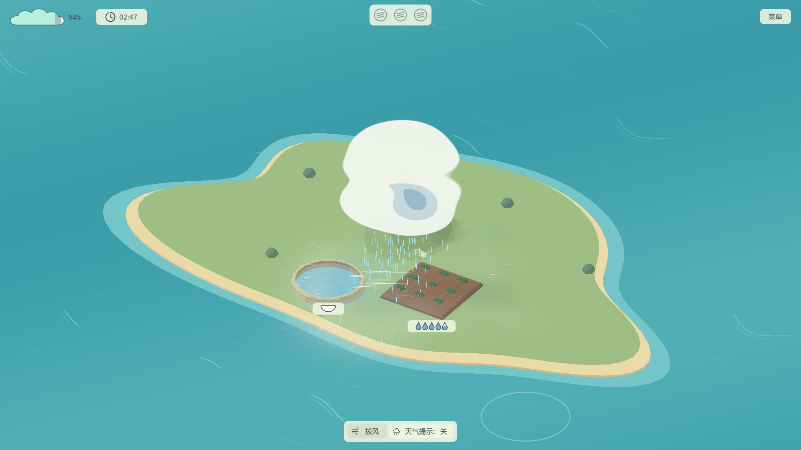

# 《风织雨》开发者日志⑤：云雨之外，哪些细节在影响“拨风”的感觉？

玩《风织雨》时，你需要从画面里判断哪里有水汽、风往哪里走、雨落在哪里。如果这些东西看不清，操作就容易变成猜测。

这一篇介绍几处与观感有关的调整。它们没有增加新的天气规则，但会影响拨动一片空气时的感觉。

## 找得到水汽，才知道从哪里开始

地面湿空气最早用稀疏细点表现，试玩时感觉存在感不够。后来换成淡色覆盖与缓慢流动的细丝，让这里有可搬运的空气更容易被注意到。

白色风线则表达实际气流。需要更明确的信息时，可以打开底栏的天气提示：它会同时显示移动箭头与地面的实际降雨范围。新会话默认关闭这组额外提示，白风线和雨线仍会保留。

界面也逐渐缩小。田地和水库的信息放在各自旁边，字母与受雨范围在悬停时显示；工具栏只提供当前关卡能用的工具，减少挡住天气的面积。

## 地面曾经加过细节，后来又撤回了

为了让岛屿更丰富，制作中尝试过草地色块、稀疏草纹和雨后湿痕。实际反馈认为颜色过渡生硬，现阶段的收益也不高，随后撤回了这一轮普通地面表现。

目前普通地面保留纯色；田土随灌溉变深、田池的厚度和弱接触影仍然保留，因为这些变化与地块状态和位置更直接相关。

这个取舍让画面继续保持简洁，也给风线和云的层次留出了空间。未来是否还要补充地面细节，可以等更明确的需要出现后再讨论。

## 拨风的声音，从移动时开始

鼠标按下时不立刻响，开始有效拨动后，才触发这一笔的短风声。持续移动时，音高会随速度平滑变化，同一笔不反复重新起音。

因为拨风会频繁使用，还准备了五条声音差分轮换，减少每一次操作都听见完全相同声音的感觉。风带和漩涡则使用渐起的风底，关闭后随实际残风逐渐退下。

## 远处的雨，不该像落在耳边

雨声也改过几轮。早期户外录音里的叶片和地面雨滴很清晰，能让人马上想到下雨，却和俯视远景不太搭。

后来对雨源作远景滤波和软峰值处理，再加入渐起、渐退。希望云下雨量增加时，声音也慢慢铺开，减少近处雨滴突然噼啪出现的违和感。

背景音乐使用Écrivain的《Meadow Thoughts》，风雨也采用已有作者素材再加工。音乐和声音的来源会在鸣谢里列明，并非全部原创录制。

## 目前进展

水汽细丝、紧凑界面、短拨差分和远景雨声已接入，主界面、关卡流转与声音设置也已具备。

## 还在打磨的地方

长时间操作是否听腻、新玩家能否发现提示，以及密集天气的性能问题，都还需要反馈。

## 接下来准备做什么

优先观察首次读图和反复拨风的体验，再处理真正影响游玩的细节。

#聚光灯gamejam开发者日志
