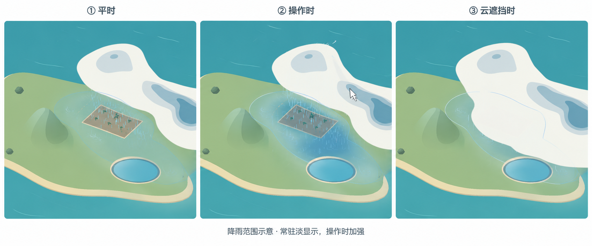

# 下一阶段：实际降雨范围与统一天气提示

日期：2026-10-13。状态：已实施，完整回归与正常路线通过，已更新独立Windows试玩包。雨区试玩反馈和正式60秒性能验收继续开放。起始存档为 `542de4d`。

## 1. 已确认目标与范围

用户认可“下雨时一直淡显示，操作时加强”，以及地面淡蓝覆盖、细轮廓、少量落雨涟漪与云遮挡时仍可辨认边界的示意。雨区提示与现有天气箭头共用一个开关，不增加第二个按钮。

图片为生成的视觉示意，不是实际采样或已实现截图。实际形状必须由本局落雨数据产生，可移动、分裂、合并，不照搬示意图的轮廓。默认开启，不改天气、风手感、地块接雨、危险缓冲、星级、地图或时限。风暴、山坡和冷风形成的雨都使用相同提示。

## 2. 玩家能看到什么

- **平时**：正在落雨的地表有很淡的灰蓝／青蓝覆盖和细轮廓；少量小涟漪暗示雨正在落下，不铺满圆环或变成水面。覆盖允许经过农田、池面、山坡和海面。
- **雨量**：雨强越高，内部略深；色深只表示当前强弱，不表示累计水量、地块损坏或未来将下多少雨。弱雨仍有边界，不因着色浅就缩小范围。
- **操作时**：悬停雨云或拨动雨云时，对应雨区增强，其他雨区仍保持日常强度。松开／移开后约0.3秒回到日常强度；这段只是视觉初值。
- **云遮挡时**：填色与涟漪仍在云下，只让较淡的地面投影轮廓透过云可见。保持云原有不透明感，不将整团云染蓝或透明化。
- **停止降雨**：当前位置没有实际雨后取消覆盖，已经开始的少量涟漪可在约0.2秒内收尾；不保留数秒旧覆盖，避免被理解为还在下雨。

蓝色雨区与原金色农田安全缓冲必须可区分。雨区表达当前落点，危险缓冲还包含成雨进度和附近威胁；没有蓝区不保证农田已安全。池水位、农田水量条及原雨线继续保留。

## 3. 与箭头共用开关

沿用底部原生按钮及位置，将文字改为 **“天气提示：开／关”**，说明中明确控制“流向箭头＋降雨范围”。按钮宽度沿用现有布局，不能扩成新面板。

- 开启：天气移动／抬升箭头，以及雨区覆盖、轮廓、涟漪同步启用。
- 关闭：以上辅助提示同步隐藏；白色风线、实际雨线、风源位置／方向／寿命标记、自然系统中心和地块信息继续保留。白线仍是实际气流的符号。
- 保持原默认开启，当前会话重试、切图和模式切换保留选择；不新增跨启动偏好文件。
- 暂停时冻结雨区形状、涟漪和增强过渡，仍可切换提示的显隐。恢复后不补播暂停期间动画。
- 结算隐藏辅助雨区与箭头，原天气和结果画面按现有流程处理。重试清空旧纹理／增强状态，再从正式开局发布新数据。
- 提示不创建鼠标阻挡区域；按钮本身仍按原界面规则阻挡拨风，跨帧按下／松开保持有效。

实现用一个视图侧的共同提示状态，更新旧 `arrows_enabled` 调用和测试入口，避免箭头与雨区各保存一份可能不同步的状态。开关不进入模拟规则。

## 4. 数据与渲染实现

### 真实落雨数据

`rain` 仍是总云水的降雨子集，不等于本步已经落地的量。模拟在现有降雨循环计算 `fallen` 时，额外记录各格 `fallen / dt`，作为只读的当前落雨速率字段；每个真实固定步清零并重填，随同一次显示发布更新。它不参与水分相加、风力或结算，也不重新计算另一套降雨。

渲染发布一张64×56小纹理：实际速率决定色深，独立的非零覆盖标记决定范围。不从整片云、云影、稀疏雨线样本或HUD危险区推测范围。开发直接注入雨水的夹具须推进真实固定步再验雨区，不能把云纹理当落雨记录。正式路线继续从地图正常开局。

范围继承原0.5单位网格精度。显示可做抗锯齿与窄边柔化，但不能漏掉整格弱雨、把干燥间隙填成雨区，或把平滑产生的外延算作真实接雨。雨区移出模拟范围后按实际剩余落雨显示，不额外重复套云的边界消散。

### 地表与穿云轮廓

首选两次轻量GPU绘制，共用落雨纹理及当前不透明场景深度：

1. 在云前绘制地表填色与稀疏涟漪，从深度恢复实际可见地表位置，正确落在土地、池面与海面。
2. 在云后只绘制细轮廓；仍按地表坐标取雨区，不能沿云的屏幕轮廓描边。使用可见不透明表面约束，山体／前景遮挡不因穿云提示而被整体透视。

复用 `cloud.gdshader` 已使用的正交相机深度重建方式，固定Godot 4.7.2／Forward+／D3D12。关闭提示或没有雨时跳过绘制，不创建额外全尺寸数据视口，也不重复执行32步云光线采样。视觉初值集中在渲染端设置，包含颜色、日常／加强透明度、轮廓宽度和过渡时间；本轮不新增配置系统或游戏内滑杆。

### 操作增强

输入复用现有云拾取结果，附带命中层信息，不逐帧额外做一次云射线步进；拖动仍沿原按下时锁定的参考面。渲染按当前雨区连通关系，选取命中位置／现有风刷范围内对应的实际雨区；只加强所选区域。没有对应降雨的云不凭空显示蓝区，地面普通拨风和风源预览不自动点亮所有雨区。连通索引只在落雨覆盖发布变化时按需刷新，支持分裂／合并，无需为云新增可拖拽实体。

进入实际控件、离开视口、失焦、暂停和取消手势按现有输入生命周期处理，不能留下永久加强状态。动画读原暂停可冻结的显示时钟，颜色和提示不反向提交风或改变模拟。

## 5. 实现顺序

1. 接入只读本步落雨字段与纹理，先检查小雨、局部雨、分离雨区、边界和池面位置。
2. 完成日常填色、轮廓及云下／穿云两种呈现，先保证农田边缘能够辨认，再加少量涟漪。
3. 接入已有拾取的局部加强、增强回落和统一开关，更新按钮说明、入门提示及原开关测试。
4. 完成场景、正常路线、性能与独立包验证，保存少量实机图，更新看板和策划。不修改地图或规则来让截图更好看。

## 6. 验证与交付

- **数据**：零雨不显示，厚云尚未降雨不显示；局部／分离／弱雨覆盖、实际落雨速率、余雨耗尽、云雨同步搬运、四边及角落出流正确。区域和地块实际接雨位置在原网格精度内一致，蒸发、溢流及原水分收支无变化。
- **画面**：小雨和大片风暴雨的覆盖都可读；农田、池面、山与海面投影正确；云遮住地面仍能看边界，不能照亮整团云。区分蓝色落雨、灰色云影、金色安全缓冲。审阅1920×1080及1280×720，核对轮廓厚度和原云边连续性。
- **输入**：悬停／拖动加强对应雨区，另一片不被一起加强；无雨云不加强；进入界面、取消、失焦、暂停、重试和切图正确。雨区不挡输入，真实跨帧点击统一开关，关掉后两种提示同时消失，白线／雨线／风源标记保留。
- **确定性**：同一正常输入分别开／关提示，比较天气数组、目标水量、完成状态与收支，不能因渲染提示改变玩法或随机数。真实GPU检查不能用headless代替。
- **完整流程**：运行相关检查及完整回归，重复原一田一池、热带先蓄池／先农田的正常路线和农田损坏后继续；真实鼠标核对云边拾取与移云落点。夹具与正常通关证据分开记录。
- **性能**：实际1920×1080，热带主题图先做同协议六项短压力对比，包含两人工源、箭头和雨区；记录开／关提示的CPU／GPU、P95、P99、长帧、推进及积累。云32步、天气箭头32、白线48、雨线750预算不增加；涟漪在GPU按少量固定图样绘制，无逐滴节点。不得丢模拟步、减少覆盖或改变云形换性能。
- **正式验收**：原两图12项＋主题图6项的5秒预热／60秒采样仍按用户安排留到空闲。门槛保持P95≤16.7ms、P99≤20ms、推进≥99%、结束积累≤100ms，短诊断不替代正式验收。原生异常待办继续保留。

交付源码、统一提示操作、正常路线及开关对照记录、少量实机审阅图、更新后的看板／说明及重新导出的本地Windows包。用户本次认可的是示意方向，实际动态画面的可读性和强弱仍需试玩确认；本阶段不扩展新天气或投稿工作。

## 7. 实施结果

- `ground_rain` 记录真实落地速率，不影响收支；雨区深度投影、局部雨云增强和天气提示共用开关已接入。
- 12项模拟字段检查、22项GPU场景检查（1920×1080与1280×720各跑一遍）通过；全套规则、30条完整流程、两条热带真实鼠标路线及五份路线比较完成。
- 最终10秒性能对照中，提示开启最高P95 18.491ms、P99 19.715ms；关闭时最高P95 17.061ms、P99 18.697ms。均无33ms长帧且推进正常，但强拖动样本的P95未全部达到16.7ms，正式60秒测量仍留到空闲。数据见[rain-area-review.json](rain-area-review.json)。
- 正常热带画面存于[雨区实机图](previews/rain-area-play.png)；更新后的独立包仍放在 `.godot/WeavingRain-preview.zip`。
